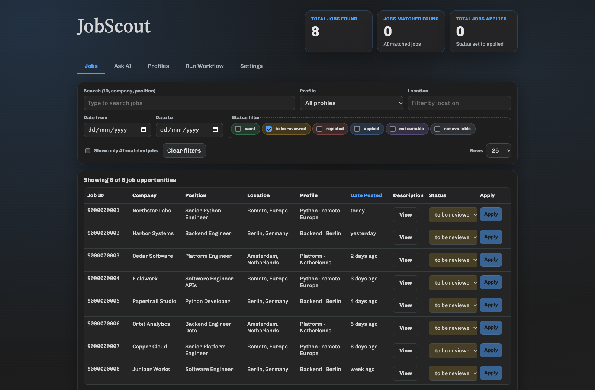
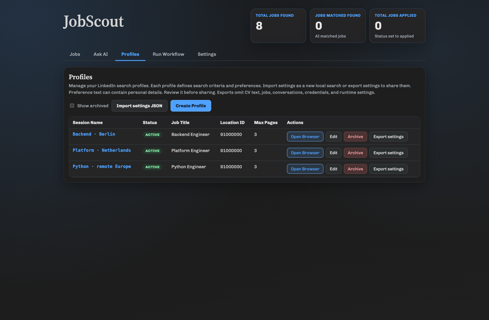
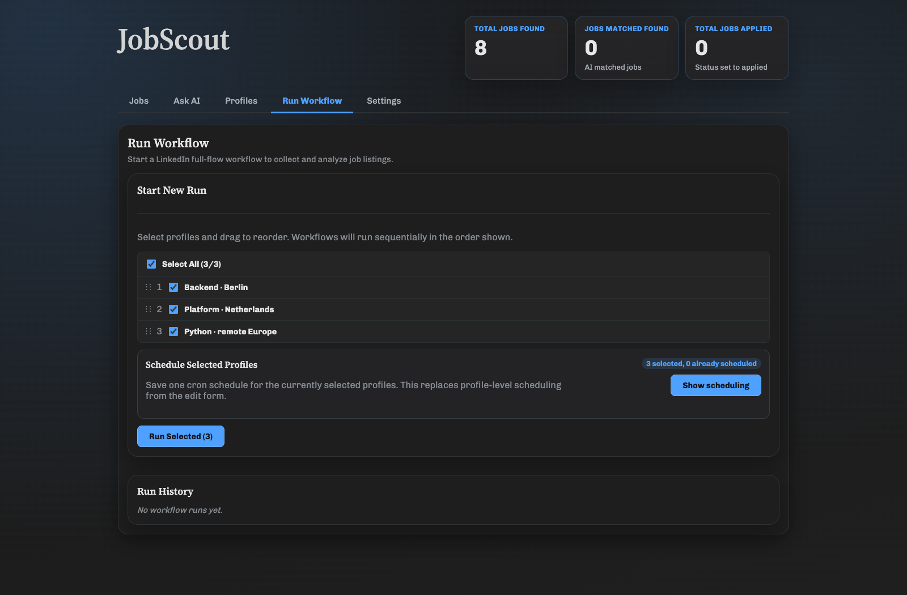

# JobScout

JobScout collects LinkedIn job listings into a local portal where you can read
descriptions, keep a shortlist, and track applications. Save a few searches,
sign in to LinkedIn once in the dedicated browser, and run them when you want
fresh results.

Optional AI features explain requirements, check jobs against your exclusions,
draft cover letters, and help with application questions. You choose the AI
provider. Collecting and reviewing jobs works without one.



<p>
  
  
</p>

*Screenshots use fictional jobs and sample searches.*

## Install and open the portal

JobScout runs on your computer. The native setup targets macOS and Ubuntu
24.04 desktop; see [native setup](docs/native-setup.md) for the tested versions
and remaining desktop checks. This is an early preview.

Before installing, you need:

- Python 3.11 with `venv` support.
- Node.js 22.23.3 and npm 10. The Node version is also in `.nvmrc`.
- A Chromium-based browser, version 142 or newer: Chrome, Helium, Chromium,
  Brave, or Edge. It must support Chromium remote debugging.
- Your LinkedIn account for collecting jobs.

Run these commands in a terminal:

```bash
git clone https://github.com/dartyuhov/jobscout.git
cd jobscout
bash scripts/bootstrap.sh
bash scripts/start.sh
```

Open [the local portal](http://127.0.0.1:3000). Keep the terminal running while
you use it. Press **Ctrl+C** there to stop the app; run
`bash scripts/start.sh` again next time.

Bootstrap installs dependencies and builds the portal. Rerunning it preserves
your saved jobs, settings, and browser login. If your browser isn't detected,
set `JOBSCOUT_BROWSER_PATH` to its executable path before bootstrap and keep
that setting when starting the app or using the CLI.

## Create your first search profile

A search profile is a saved LinkedIn search: its filters, page count, and your
preferences. You can have separate profiles for different roles or locations,
such as “Python remote” and “Backend Berlin.”

1. Open LinkedIn Jobs and set the keywords, location, and filters you want.
2. Copy the search URL from the address bar.
3. In JobScout, open **Profiles**, then **Create Profile**.
4. Paste the link into **LinkedIn Jobs search URL**. Check the filter preview.
5. Enter a **Profile name** you'll recognize later.
6. Set **Max Pages**, the number of search-result pages to collect. The default
   is five; use a smaller number for your first run.
7. Optionally fill in **Want** and **Not Want**, then select **Create Profile**.

Pasting a search link fills in fields such as **Job Title**, **Location Geo ID**,
**Time Posted Range (f_TPR)**, and **Work Type (f_WT)**. You don't need to look
up those LinkedIn codes yourself. Other search filters in the link are kept;
tracking and pagination parameters are removed.

Use **Want** to record what you're looking for, and **Not Want** for exclusions
such as “internships, unpaid roles, mandatory relocation.” Current AI job
analysis uses **Not Want** and the job details. It doesn't score jobs against
**Want** or your CV.

Keep **Headless** off until you've signed in and completed a successful run.
You can enable it later to collect without a visible browser window.

## Sign in to LinkedIn

JobScout uses one dedicated browser profile for all your searches. That browser
profile holds your LinkedIn login. A saved search profile doesn't create a
separate LinkedIn account or browser identity.

1. In **Profiles**, select **Open Browser** beside your saved search.
2. In the browser window that opens, sign in to LinkedIn.
3. Complete any two-factor authentication or account checks yourself.
4. Confirm you can see LinkedIn Jobs, then return to the portal.

Your login stays in JobScout's private browser storage when you close the
window or restart the app. Your everyday browser profile isn't copied or
modified. You don't enter your LinkedIn password into the portal.

All searches use whichever LinkedIn account is signed in to that dedicated
browser. To change accounts, open it again, sign out of LinkedIn, and sign in
with the other account. Changing the account affects every search profile.

**Open Browser** always opens a visible window, even for a headless search.
Changing a search's headless setting restarts the dedicated browser while
preserving its login. Browser work takes turns across manual runs, schedules,
and the CLI, so an action may wait for the current one to finish.

## Collect jobs

Use **Run Workflow** to collect listings from one search or a batch of searches.

1. Open **Run Workflow** and check the profiles you want to run. All profiles
   are selected initially.
2. Drag profiles into the order you want.
3. Select **Run Selected**.
4. Watch the progress and open entries in **Run History** for results and logs.
5. Open **Jobs** when collection finishes.

Each workflow opens the saved search, collects job IDs, reads the individual
job pages, and closes its tracked browser session. Searches in a batch run
sequentially. A failed job page doesn't stop the remaining pages from being
parsed; check the run details for failures.

AI stages are skipped until you've configured AI and enabled automatic
processing. A run can collect jobs successfully with AI skipped.

If LinkedIn asks you to sign in again or complete a challenge, use
**Profiles → Open Browser** to resolve it, then retry the run. Use the cancel
control in the run's progress panel when you need to stop an active run.

### Schedule searches

Schedules run through the local app, so keep JobScout running and your
computer awake for the scheduled time.

1. In **Run Workflow**, select the profiles to schedule.
2. Select **Show scheduling** and choose a schedule or enter a cron expression.
3. Review the upcoming run times, then select **Save Schedule for Selected**.

For example, `0 9 * * 1-5` runs at 9:00 a.m. on weekdays in the backend
computer's local time zone. The scheduling panel lists active schedules and
the next run. Select profiles and use **Clear Schedule for Selected** to
remove their schedules.

## Review jobs and track applications

The **Jobs** screen is your review queue. It starts with jobs marked
**to be reviewed**, including jobs that haven't had any AI analysis.

- Search by job ID, company, or position. Narrow results by profile, location,
  date, or status, and select column headings to sort.
- Select **View** in the **Description** column to open a job. Expand
  **About this role** to read the full description.
- Use the status menu to mark a job **want**, **applied**, **rejected**,
  **not suitable**, or **not available**.
- In job details, **Applied** marks the job as applied and moves to the next
  result. **Skip** marks it as not suitable and moves on.
- Use the left and right arrows to move between jobs on the current page.
  The keyboard arrow keys work too; **Escape** closes the details.

**Open Job** opens the LinkedIn listing, or the saved application link when
there's no LinkedIn job ID. Complete the application on that site, then
mark it **applied** in JobScout. Marking a status doesn't submit an application.
Links open in your regular browser, which may have a different LinkedIn login
from JobScout's dedicated collection browser.

If a job disappears after you change its status, select that status in the
filters to see it again. **Clear filters** returns to the default review queue.
Leave **Show only AI-matched jobs** unchecked to include unanalyzed jobs.

## Set up optional AI

AI calls go directly from JobScout to the provider you configure. You can use
a hosted or local OpenAI-compatible Chat Completions endpoint.

1. Open **Settings** and find **AI connection**.
2. Enter **AI base URL**, including the API path. For example,
   `https://api.openai.com/v1` or `http://localhost:1234/v1` for a local server.
3. Enter the provider's model identifier in **AI model**.
4. Enter **AI token (optional)** if the provider requires one.
5. Select **Save AI connection**, then **Test saved connection**.
6. Wait for **AI connection verified** before using AI features.

JobScout adds `/chat/completions` to the base URL. Don't enter the complete
completions endpoint or put credentials in the URL. Retest after changing the
URL, model, or token. The test sends a short sample prompt, without jobs or CV
text, and may incur provider charges.

The token is stored unencrypted in your private backend database, including
its backups. The saved value isn't returned to the browser. Leave the token
field blank to keep it, enter a new value to replace it, or use
**Remove saved token** to delete it.

### Analyze, summarize, and draft cover letters

Open a job's details to use these actions after verifying your AI connection:

| Action | What you get | Context sent to your provider |
| --- | --- | --- |
| **Analyze Job** | A match decision and reasoning based on exclusions | Job details and the search profile's **Not Want** text |
| **Summarize** | Must-haves, nice-to-haves, company details, and application type | Job description, company, and position |
| **Cover Letter** | A cover letter downloaded as a text file | Saved CV and job context |
| **Ask AI** | A conversation with that job attached | Your messages and selected job context; CV context when needed |

For cover letters, first paste your CV into **Settings → CV / Resume Text**
and select **Save Settings**. Read and edit the downloaded letter before using
it. You can still read previously saved summaries and reasoning when AI isn't
configured.

To process jobs automatically, enable either option under
**Settings → Automatic AI processing**:

- **Automatically analyze collected jobs** runs analysis during collection.
- **Automatically summarize matched jobs (including existing matches)** also
  processes saved matches that don't have summaries yet.

Both start off. Saving or testing a connection leaves them off. Enabling them
permits recurring provider requests and possible charges. Neither automatic
feature sends your CV.

### Use Ask AI

Open **Ask AI** for job-search questions, or open it from a job to attach that
listing. Use the job search in the screen to attach a different saved job.

Choose **General**, **Job Analysis**, **CV Review**, or **Application Answer**.
For example, use **Application Answer** and paste an employer's question, or
ask **Job Analysis** which requirements need more explanation. CV review and
application answers require a saved CV. For personal-fit questions in other
modes, select the option to include CV context.

Messages and the required job or CV context go to your selected provider.
Changing the attached job clears the conversation after confirmation. Copy
answers you want to keep before leaving the screen; the chat isn't a saved
conversation history. AI produces text and doesn't apply for jobs or control
your browser.

## Manage searches and portal settings

Use **Profiles** to maintain searches and **Settings** for preferences shared
across the portal.

- **Edit or duplicate a search:** select **Edit** beside a profile. Update it,
  or use **Duplicate**, give the copy a name, and save it as a new profile.
- **Archive a search:** select **Archive** to remove it from active workflows
  while keeping jobs and run history. Enable **Show archived** and select
  **Restore** to use it again.
- **Share search settings:** select **Export settings** to download
  `search-settings.json`. Use **Import settings JSON** to create a new local
  profile. Each import creates a separate search with no schedule; it doesn't
  update an existing one. Exports include search filters, page count, and
  preference text, which you need to review for personal details. They omit
  your CV, jobs, credentials, browser login, and generated content. You can try
  [the sample settings file](examples/search-settings.json).
- **Ignore companies:** in **Settings → Ignored Companies**, enter one exact
  company name per line and select **Save Settings**. Matching ignores case
  and surrounding spaces. Matching jobs in the review queue are marked
  **not suitable**.
- **Change appearance:** choose **System**, **Light**, or **Dark** in
  **Settings → Appearance**, then select **Save Settings** to keep it.
- **Get completion notifications:** enable **Browser system notifications**
  in Settings and allow browser notifications when prompted. Keep the portal
  open to receive a notification when a whole workflow batch finishes.

If JobScout's browser gets stuck, open **Settings → Chrome Profiles** and
select **Check Active Status**. **Kill** cleans up the selected configured
browser profile; **Kill All Active** cleans up all active configured profiles.
Cleanup also cancels runs using those profiles. Use it when you intend to stop
that browser work.

## Where your data lives

Jobs, search profiles, CV text, generated content, settings, and workflow logs
stay in local application storage outside the checkout. AI features send the
context described above to your provider; collection connects to LinkedIn.

| System | Default storage folder |
| --- | --- |
| macOS | `~/Library/Application Support/job-search/` |
| Ubuntu | `$XDG_DATA_HOME/job-search/`, or `~/.local/share/job-search/` when unset |

The folder contains `linkedin_jobs.sqlite3`, persistent browser data in
`chrome/Default`, tracked sessions in `sessions.json`, and run reports in
`logs/`. Treat backups as private: they can contain your CV, browser login,
and saved AI token.

Set `JOB_SEARCH_DATA_DIR` to use another storage folder. `DB_PATH` and
`SESSIONS_PATH` override the individual database and session files. Keep the
same environment settings for the portal and CLI, and use absolute paths.
Runtime storage must be outside the checkout. See
[private storage details](docs/native-setup.md#private-storage) for setup.

## CLI workflow

Use the CLI when you want to run searches from a terminal. After bootstrap,
activate the environment and find the ID of a search created in the portal:

```bash
source .venv/bin/activate
job-search profiles list
job-search profiles show 1
```

Run a complete collection for that saved profile, replacing `1` with its ID:

```bash
python scripts/linkedin_full_flow.py --profile-id 1 --repo "$(pwd)"
```

The script collects IDs, parses jobs sequentially, and closes its tracked
session. It uses the same AI settings and automatic-processing opt-ins as the
portal. Exit codes are `0` for success, `2` for partial parsing failure, and `1`
for fatal failure. Reports go into the private `logs/` folder.

For manual browser login from the terminal, run `job-search linkedin login`
and press Enter when you've finished signing in. For individual collection
steps, use these commands with your own profile ID, job ID, and session name
from `profiles list`:

```bash
job-search linkedin launch --profile-id 1
job-search linkedin get-job-ids --profile-id 1
job-search linkedin parse-job JOB_ID --profile-id 1
job-search linkedin close --session-name "Python remote"
```

Individual browser commands take turns, but another request can run between
them. Use the full-flow script to keep the collection together. Closing by
session name targets that session; `close --all` closes every tracked session.
All processes must use the same `JOB_SEARCH_DATA_DIR` for browser coordination.

Use `job-search --help` and `job-search linkedin --help` for command options.
To select another database, put `--db-path /absolute/path/jobs.sqlite3` before
the subcommand. Profile IDs belong to the selected database. Restore archived
profiles in the portal before running them.

## Troubleshooting

Start with the failed run's details in **Run Workflow** for collection errors.

| Problem | What to try |
| --- | --- |
| No jobs in the review queue | Check run results, selected profiles, status filters, and the AI-matched toggle. **Clear filters** restores the default review queue. |
| LinkedIn login or account challenge | Open **Profiles → Open Browser**, complete the check, then retry. |
| Browser won't start or stays locked | Check the browser executable and version. Inspect **Settings → Chrome Profiles** and clean up stuck JobScout browser work. |
| AI buttons are disabled | Save and test the connection in **Settings**. Retest after changing its URL, model, or token. |
| Cover letter or CV review needs a CV | Paste plain text into **Settings → CV / Resume Text** and select **Save Settings**. |
| AI analysis or summaries fail with invalid output | These features need a model that follows the requested JSON format. Check the model and retry. A successful connection test only verifies text generation. |
| Portal won't start | Check [native setup troubleshooting](docs/native-setup.md#troubleshooting). For another port, run `PORT=3001 bash scripts/start.sh`. |

## Development

For code changes, read [AGENTS.md](AGENTS.md) for repository-specific guidance.
Install Python development dependencies after bootstrap:

```bash
source .venv/bin/activate
python -m pip install -e '.[dev]'
```

Run checks relevant to your changes from the repository root:

```bash
ruff check .
ruff format --check .
python -m pytest
node --test backend/*.test.js
node --test frontend/src/utils/*.test.js
npm --prefix frontend run build
python -m build
```

See [native setup](docs/native-setup.md) for installation verification,
[AI instruction provenance](docs/ai-instruction-provenance.md) for prompt
sources, and [public source export](docs/public-source-export.md) for preparing
release contents.

## License

JobScout is [MIT licensed](LICENSE), copyright Dzmitry Artsiukhou. See
[third-party notices](THIRD_PARTY_NOTICES.md) for dependency licenses.
